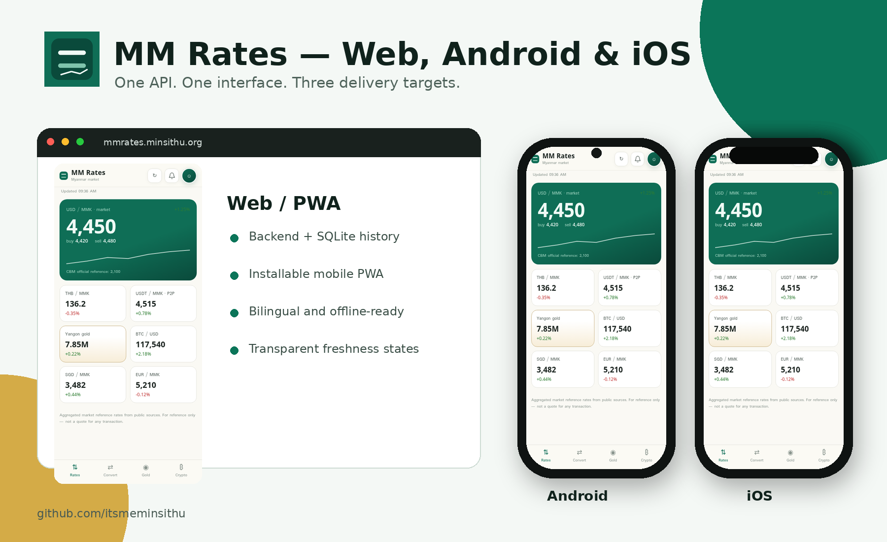

# MM Rates

> Myanmar exchange rates, CBM official references, Yangon gold, crypto, conversion, charts, bilingual English/Burmese UI, and transparent freshness information — delivered as Web, Android, and iOS projects from one repository.



**New here?** See [`QUICK_START.md`](QUICK_START.md), or double-click `RUN_DEMO_ON_MAC.command`.

## Repository structure

| Folder | Purpose |
|---|---|
| [`Web/`](Web/) | Canonical Node.js API, SQLite history collector, PWA, admin endpoints, Docker, PM2, Caddy, tests, privacy policy, and methodology page |
| [`Android/`](Android/) | Android Studio project that presents the same Web experience in a secured native WebView shell with native refresh, sharing, and offline recovery |
| [`iOS/`](iOS/) | SwiftUI/Xcode project using WKWebView with the same interface, native refresh, sharing, safe external links, and offline recovery |
| [`scripts/`](scripts/) | Repository structure check (`verify-repository.sh`) |
| Root docs (`QUICK_START.md`, `RELEASE_CHECKLIST.md`, `REPOSITORY_SETUP.md`, `STORE_LISTING.md`, `Makefile`) | Setup, release checklist, store copy, and build/demo commands |

There is no `GitHub/` folder and no `.github/` folder in this repository. The setup and release documents live at the repository root, and no CI workflow is included (see `REPOSITORY_SETUP.md`).

## Architecture

```text
Android app ─┐
             ├── hosted MM Rates Web/PWA ── MM Rates API ── SQLite
 iOS app ────┘                                 │
 Browser/PWA ───────────────────────────────────┘
                                               ├─ CBM
                                               ├─ CoinGecko
                                               ├─ Binance P2P
                                               ├─ verified manual market fallback
                                               └─ manual Yangon gold
```

The PWA is the canonical product. Android and iOS are native shells around the same deployed HTTPS app, so all platforms share one UI, one API contract, one profile/settings experience, and one release of the rate logic.

## Fastest UI preview — no npm required

```bash
cd Web
python3 scripts/demo_server.py
```

Open `http://localhost:3000`.

This uses mock rates and does not collect production data.

## Run the real Web backend

```bash
cd Web
cp .env.example .env
npm ci
npm test
npm start
```

Open `http://localhost:3000`.

Production requires a strong `ADMIN_TOKEN`, HTTPS, backups, monitoring, and current verified market data. Read [`Web/DEPLOYMENT.md`](Web/DEPLOYMENT.md).

## Android

Open [`Android/`](Android/) in Android Studio. Debug defaults to `http://10.0.2.2:3000`, which routes the Android emulator to the host computer.

```bash
cd Android
./gradlew test
./gradlew assembleDebug
```

Set the production URL with:

```bash
./gradlew bundleRelease -PMM_RATES_RELEASE_URL=https://your-domain.example
```

See [`Android/README.md`](Android/README.md).

## iOS

Open [`iOS/MMRates.xcodeproj`](iOS/MMRates.xcodeproj) in Xcode. Debug defaults to `http://127.0.0.1:3000` for the iOS Simulator. Change [`iOS/Configuration/Release.xcconfig`](iOS/Configuration/Release.xcconfig) before archiving.

See [`iOS/README.md`](iOS/README.md).

## Live preview

There is no GitHub Pages preview for this repository. The Web app is not static HTML: `Web/public/app.js` calls the Node.js API (`/v1/latest`, `/v1/history`, `/v1/refresh`), so serving `Web/public/` alone from Pages would leave the UI without data. Use the local demo above for a UI preview (mock rates only); the real app needs the Node.js server running.

## Repository status

This repository is already published. The `Web/`, `Android/`, `iOS/`, and `scripts/` source trees were previously stored only as zip files at the root; they are now extracted in place and the zips are removed. See the pull request description for the binary files that could not be pushed through the GitHub connector and still need to be added.

## Important data warning

MM Rates displays aggregated public reference rates. It is not a transaction quote. The automatic community market feed may be stale and is rejected when its provider timestamp exceeds the configured age limit. Use a verified manual fallback or integrate another reliable market source before public launch.

## Version

- Multiplatform repository: **1.4.1**
- Web/PWA cache: **`mmrates-shell-v8`**
- Developer: **Min SiThu**
- Website: **https://minsithu.org**
- GitHub: **https://github.com/itsmeminsithu**
- Contact: **alex@minsithu.org**

## License

ISC — see [`LICENSE`](LICENSE).
